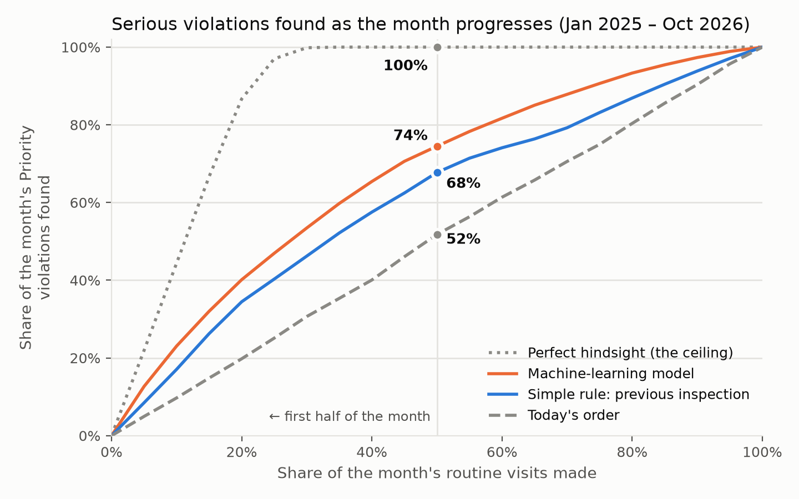

# Which Boston restaurants should inspectors visit first?

A monthly priority list for Boston's routine food inspections, built from public data. It changes
the **order** of the month's inspections, not their number, so that kitchens with serious hazards
are visited first.
*MIT 15.071 The AI Edge, Fall 2026 · Project 1*

## The task
- **Stakeholder:** the Commissioner of Boston's Inspectional Services Department (ISD), who runs
  the health inspectors. This README is written for a data scientist on ISD's or the city's
  analytics team.
- **Unit:** one routine inspection of a restaurant, take-out or retail food store (about 470 a
  month). The city's schedule decides who is due, and that stays fixed.
- **Label:** the visit finds at least one **Priority violation**, the FDA Food Code class for
  hazards that directly cause foodborne illness. That's about 22% of visits.
- **Inputs:** only what is known on the first day of the month: the establishment's inspection
  record, how strict recent inspections have been within 1 km, and inspectors' notes from its last
  two inspections.
- **Metric:** the share of visits in the first half of the month that find a Priority violation.
  It is compared with today's order, a no-ML rule ("places whose last inspection found a Priority
  violation or failed go first") and perfect hindsight.

## Data and approach
- **Data:** 20 years of [Analyze Boston inspection records](https://data.boston.gov/dataset/food-establishment-inspections)
  (908k violation rows, about 217k visits) and 311 complaints. The data is downloaded by script and
  never stored in the repo. Personal names are dropped or hashed.
- **Tabular models:** logistic regression and LightGBM (tuned, ranking objective, longer history).
  The chosen model is a **33-input logistic regression**, the simplest within noise of the best.
- **Inspector notes:** TF-IDF, sentence embeddings and fine-tuned DistilBERT. Each text score is
  stacked onto the tabular model. TF-IDF was kept; the deep models added nothing on top of it.
- **Validation:** every input is computed as of the month's start, with truncation tests against
  leakage. Choices were made on 2022–23 folds and checked on 2024. **January 2025 – October 2026
  was scored once at the end.** Confidence intervals come from resampling months.

## Results (test period, 11,198 routine inspections)
| Order of visits within the month | First-half visits finding a Priority violation | Days sooner each is found |
|---|---|---|
| Today's order | 23.2% | — |
| No-ML rule: previous inspection | 30.3% | 3.0 |
| **Model** | **33.3%** | **4.9** |
| Perfect hindsight (ceiling) | 44.7% | 11.2 |

<picture>
  <source media="(prefers-color-scheme: dark)" srcset="results/figures/readme_capture_curve_test_dark.png">
  
</picture>

- **Model vs the rule:** +3.0 hits per 100 early visits [+2.3, +3.7]. The gain holds in each year
  and for each license type. The model without the notes scores 33.0%, so the notes' contribution
  is too small to detect.
- **Impact:** with the same staff, about 300 more serious violations a year are found in the first
  half of the month, and about **6,700 days of uncorrected hazards** are removed. That equals about
  1,330 extra inspections, or **about $177,000 a year** of inspector time, for about $7,200 a year
  to run.
- **Fairness:** no neighbourhood or income group is worse off than under today's order. Lower-income
  areas gain most, because hazards are more common there.
- **Limits:** the no-ML rule delivers 60–70% of the gain on its own. Part of the area signal
  reflects inspectors, not kitchens. Effects on illness are not measured; only a pilot can measure
  them.

## Reproduce
```bash
git clone https://github.com/linyutian/boston-restaurant-inspections.git && cd boston-restaurant-inspections
uv venv --python 3.14 && source .venv/bin/activate          # Python 3.12+; macOS: brew install libomp
uv pip install -r requirements-lock.txt && uv pip install -e . --no-deps
python -m inspections.download && python -m inspections.prepare   # public data, about 400 MB
pytest                                                       # 34 tests, about 10 seconds
python -m inspections.rank --month 2026-12 --due due.csv     # a month's priority list
```
- **`due.csv`:** one column, `licenseno`, listing the establishments due that month. Leave out
  `--due` to replay a past month.
- **Output:** the list is written to `data/outputs/`, ranked, with each place's last inspection
  result and notes. The model is refit on every run.
- **Full analysis:** run notebooks `01`–`06` in order with Restart & Run All. Each one logs to
  `results/experiments.csv`.

| Path | Contents |
|---|---|
| `notebooks/` | 01 data and labels · 02 metric and baselines · 03/03b tabular models and tuning · 04 inspector notes · 05 one-time test and fairness · 06 business impact |
| `src/inspections/` | the package: `download`, `prepare`, `features`, `models`, `text`, `metrics`, `rank` |
| [TECHNICAL.md](TECHNICAL.md) | methodology, full results, assumptions, limitations, recommendations, how to reuse or port the code |
| [CONTRIBUTING.md](CONTRIBUTING.md) | setup for development and the rules for changing the analysis |
