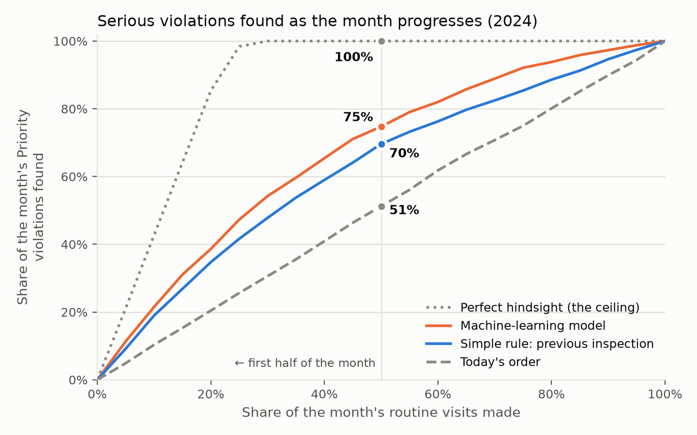

# Which Boston restaurants should inspectors visit first?

> **Work in progress.** Results are added as each phase completes.

## Motivation
Boston's health inspectors routinely visit about 4,000 restaurants and food stores, mostly in
calendar order. A kitchen with active hazards can wait weeks while a clean one is visited first.
We keep the number of inspections the same and change only the **order**: a monthly priority list
that puts the places most likely to have serious food-safety violations first. Inspectors find more
problems per visit, and the public is exposed to hazards for fewer days.

## Problem statement
- **Who:** every sit-down restaurant, take-out restaurant and retail food store that the city has
  due for a **routine** inspection in the coming month.
- **What we predict:** the probability that the visit will find **at least one Priority
  violation**, the FDA Food Code category for hazards that directly cause foodborne illness
  (holding temperatures, cross-contamination, handwashing, sanitizing). We use only information
  known **before the month starts**:
  - the establishment's own inspection record and its recent trend,
  - how strict recent inspections have been in its area,
  - the notes inspectors wrote at its last two inspections (Phase 2).

  Other signals (its owner's other establishments, nearby 311 complaints, violation types, season)
  were tested and added nothing.
- **The action:** sort the month's list by the score and visit the highest-risk places first.
- **What stays fixed:** the number of inspections, and who is due. The city's schedule still
  decides who is due; we change only the **order** within the month.
- **What we optimize:** hazards found **earlier**. The headline is the share of visits that find a
  Priority violation in the first half of each month, compared with today's order and with the
  rule "go back first to the places that were worst last time". That translates into:
  - **Residents:** hazards found and fixed days sooner.
  - **The city:** more problems found per inspector visit, with the same staff.
- **Out of scope:**
  - deciding who is due or how often,
  - complaint-driven and other irregular visits,
  - pass/fail grades, closures, or illness outbreaks.

## Approach
Twenty years of public inspection records, plus 311 complaints. Every model is tested on years it
never saw, and compared with today's order and with simple rules a city analyst could apply
without machine learning.

- **Phase 1 · structured data.** Classic machine learning on each establishment's inspection
  history and on recent inspection outcomes in its area; more complex models, tuning and extra
  signals were tested along the way.
- **Phase 2 · inspector comments.** Language models, from simple keyword models to a fine-tuned
  transformer, read the notes inspectors wrote at earlier visits and are added to the Phase 1
  model.

How the data was prepared, how the metric was chosen, and what the results assume:
**[TECHNICAL.md](TECHNICAL.md)**.

## Results

### Phase 1 · structured data
Tested on 2024 (about 5,600 routine inspections), with models trained on 2020–2023 only. No model or
setting was chosen using 2024, so it is a clean test:

| Order of visits within the month | Share of first-half visits that find a Priority violation | Violations found earlier than today |
|---|---|---|
| Today's order | 23.8% | — |
| Simple rule: places whose previous inspection found a Priority violation or failed go first | 32.4% | 3.4 days |
| **Machine-learning model** | **34.8%** | **4.9 days** |
| Perfect hindsight (the ceiling) | 46.5% | — |

<picture>
  <source media="(prefers-color-scheme: dark)" srcset="results/figures/readme_capture_curve_dark.png">
  
</picture>

*How to read it:* each line follows inspectors through a month's list and shows how many of that
month's serious violations they have found so far. Every order finds them all by the end of the
month; the higher the line, the sooner they are found. By the halfway point, today's order has
found about half of them, the simple rule 70%, and the model 75%.

- **The city's current order carries no risk information** within the month. A simple rule
  already finds far more violations early.
- **The model adds about 2.5 more Priority violations found per 100 early visits** on top of the
  rule. The gain is similar in 2022 and 2023, holds when visits may move only two weeks, and the
  risk scores are well calibrated.
- **The simplest model worked best.** More complex models, careful tuning and extra signals did no
  better: the limit is the information in the data, not the algorithm. The final model is a
  logistic regression on 33 inputs.
- **Besides an establishment's own record, how strict recent inspections have been nearby matters.**
  This likely reflects inspectors as much as kitchens, a point to handle carefully in any use.
- **What the model misses is mostly surprises:** places with clean records whose kitchens slipped.

### Phase 2 · inspector comments
Same clean 2024 check as Phase 1. The final test on 2025–26 is still to come.

| Order of visits within the month | Share of first-half visits that find a Priority violation | Share of the month's violations found in the first 10% of visits |
|---|---|---|
| Simple rule (as above) | 32.4% | 19.0% |
| Phase 1 model | 34.8% | 21.5% |
| **Phase 1 model + inspector comments** | **34.8%** | **22.6%** |

- **The comments add a little, at the very top of the list.** About one extra serious violation
  is found each month in the first few days, and overall ranking quality improves in every year
  tested. By mid-month both orders have found the same violations, so the headline does not move.
- **What the comments add is what kind of kitchen a place is** (raw meat, heavy prep), not how many
  violations it had. Counting violation types or how much the inspector wrote does not reproduce it.
- **Most of what the comments say, the inspection record already shows.** Places with more notes,
  or notes about mice, cockroaches or "repeat" violations, are much riskier (after a last inspection
  with no serious violation: 10% with no notes vs 32% with six or more). But the Phase 1 model already
  expects most of that risk.
- **The simplest text model worked best.** Word counts beat sentence embeddings and a fine-tuned
  transformer (DistilBERT). As in Phase 1, the limit is the information, not the algorithm.
- **For explaining the list to inspectors,** showing a place's last inspection notes is clearer
  than snippets picked by the model, which are often generic.

## Implications and next steps
_Coming after the final evaluation._

## Reproduce
```bash
uv venv --python 3.14 && source .venv/bin/activate    # any Python 3.10+
uv pip install -e ".[dl]"
python -m inspections.download                         # dated data snapshot into data/raw/
```
Then run the notebooks in `notebooks/` in order. Full setup: [CONTRIBUTING.md](CONTRIBUTING.md).

## Data
Public open data from [Analyze Boston](https://data.boston.gov/dataset/food-establishment-inspections).
Personal names are dropped or hashed; no raw data is stored in this repo.
