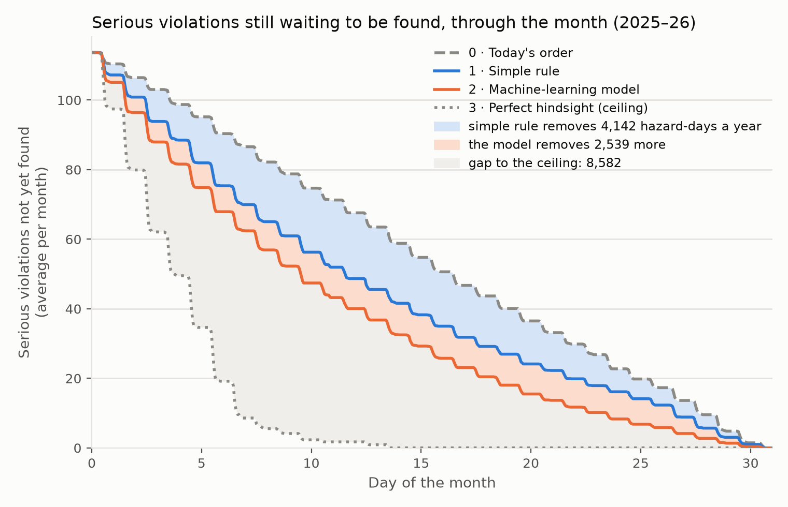

# Technical notes

How the problem was turned into a prediction task, what the data revealed, how models are judged,
and what the results rest on. Written for a data scientist who wants to understand or challenge the
work. Every claim points to the notebook section that shows the evidence.

**Contents**
1. [The problem in ML terms](#1-the-problem-in-ml-terms)
2. [Data: core findings and what they imply](#2-data-core-findings-and-what-they-imply)
3. [Prediction set and splits](#3-prediction-set-and-splits)
4. [The metric](#4-the-metric)
5. [Baselines and the bar](#5-baselines-and-the-bar)
6. [Features and leakage safeguards](#6-features-and-leakage-safeguards)
7. [Models and results](#7-models-and-results)
8. [Limitations](#8-limitations)
9. [Implications for use](#9-implications-for-use)
10. [Reusing the code](#10-reusing-the-code)

---

## 1. The problem in ML terms

| | |
|---|---|
| **Unit** | One *routine* inspection of one food establishment (sit-down FS, take-out FT, retail RF) |
| **Label** | **Hit** = the inspection cites at least one **Priority** violation (`viol_level = ***`) |
| **Decision time** | The first day of the month the visit falls in. Every input must be known by then |
| **Model output** | For each establishment due that month: the probability of a hit if it is inspected this month |
| **Action** | Sort the month's due list by that probability and visit the top of the list first |
| **Held fixed** | How many inspections happen and who is due. Only the order within the month changes |

The model does **not** predict *when* a problem will occur. It estimates whether a kitchen is
currently operating with a Priority problem, based on its track record and its surroundings.

**Stakeholder.** The Commissioner of Boston's Inspectional Services Department (ISD), whose Health
Division carries out the inspections. The choice follows from the design:
- The lever, the order of routine inspections within the month, is an ISD operational decision.
- The evaluation holds ISD's staff and schedule fixed.
- The dollar value is ISD inspector capacity, priced from ISD's own payroll (§7, business impact),
  and the running cost is ISD analyst time.
- Approving a pilot and explaining the list publicly, including the fairness check, are
  commissioner-level decisions.

Inspection supervisors who hand out the monthly lists are the day-to-day users. Residents are the
beneficiaries. The README is written for a data scientist on ISD's or the city's analytics team.

**What is optimised.** Hazards found *earlier*: the share of first-half visits that find a
Priority violation (§4). For residents, that means hazards found and fixed days sooner. For the
city, it means more problems found per inspector visit with the same staff.

**Out of scope:**
- deciding who is due or how often;
- complaint-driven and other irregular visits;
- pass/fail grades, closures or illness outbreaks.

**Signals tested and dropped** because they added nothing: the owner's other establishments,
nearby 311 complaints, violation types and calendar or season (§7, tuning round).

---

## 2. Data: core findings and what they imply

Source: Analyze Boston *Food Establishment Inspections*, a snapshot of 2026-11-10: 908,247 rows,
2006-04-04 → 2026-11-06, matching the portal's own row count. Supplemented by 311 food complaints
and rodent reports (68,360 cases, 2011–2026). For the fairness check only: median household income
by ZIP code (US Census ACS 5-year 2020–2024, table B19013, public summary file). For the business
impact only: Inspectional Services pay by title from the City of Boston Employee Earnings Report 2025,
downloaded without names. → nb 01 §1, nb 05 §7, nb 06 §7

| Finding | Evidence | Implication |
|---|---|---|
| **One row per violation, not per inspection** | 908k rows ≈ 217k visits for FS/FT/RF | Build a visit table first. A visit = (`licenseno`, `resultdttm`); only 19 visits carry two result codes → nb 01 §4 |
| **Timestamps are UTC** | 0.5% of rows fall on a different calendar date in Boston time | Convert to America/New_York before deriving dates or months → nb 01 §2 |
| **No inspection-type field.** Routine visits, follow-ups and complaint visits all look alike | Follow-ups arrive a median of 7 days after a fail (95% within 27 days); the next visit after a pass comes a median of 172 days later | Routine visits must be **inferred** from the visit sequence (§3) → nb 01 §6 |
| **The result codes have consistent meanings**, but there is no dictionary | `HE_Fail`: 99% have cited violations; next visit after 7 days. `HE_Pass`: 60% come right after a fail and list the old violations as cleared. `HE_Filed`: violations cited (mostly minor), next visit after 176 days. `HE_NotReq`: no violations at all | Roles: **fail** (`HE_Fail`, `FailExt`, `Hearing`, `TSOP`, `Closure`), **pass**, **filed** (closes a cycle; *not* a fail), **admin** (dropped), **closed** (dropped) → nb 01 §5 |
| **Failing is the norm** | 50–60% of routine visits fail, every year (2012–2026) | "Fail" says little about which kitchens are risky, which motivates a more selective target |
| **"Severe" changed meaning in 2019** | The severe share drops from 30–39% (2012–2018) to 19–25% (2020+). From 2020, every `***` row carries the FDA Food Code tag `(P)` (29,287 of 29,378); before 2019 none do | `***` is a clean, health-relevant label (**Priority violation**) only from 2020. **Labels start in 2020**; older visits are used only as history → nb 01 §8 |
| **Severe is almost a subset of fail** | P(severe \| fail) = 38%; P(severe \| not fail) = 1% | The two targets agree; Priority violation is the sharper one |
| **History is rewritten only narrowly** | `status_date` falls within 3 days of the visit for 95% of rows; later updates sit on follow-up passes | `viol_status` and `status_date` are never used as features → nb 01 §4 |
| **Some fields describe today, not the past** | `licstatus` ("Inactive" = closed at some point), `expdttm`, current business name | Never saved to the processed tables, to prevent leakage → nb 01 §3 |
| **`issdttm` is not the opening date** | 51% of licenses have an issue date more than 30 days *after* their first inspection | Not used; experience = days since the license's first recorded visit → nb 01 §3 |
| **`property_id` is a building, not a business** | 59% of licenses share a `property_id`; 54% of those overlap in time | Too coarse to carry history between licenses; each license stands alone → nb 01 §3 |
| **311 complaints carry coordinates, not license numbers.** Distance matching over-flags dense blocks | A 25 / 50 / 100 m radius flags 9.5% / 12.4% / 19.1% of routine visits, and 2–3× as many in dense blocks (> 10 licenses within 50 m) as in sparse ones | Attribute each complaint to *one* visit (§3) → nb 01 §7 |
| **Coverage is uneven by license type** | About 470 routine visits a month (in 2024: FS 215, FT 192, RF 62); 10% of licenses lack coordinates; owner recorded for about half | Results are pooled across types and also broken out. RF estimates are noisier |

Privacy: contact names are dropped and owner names are hashed at load. No personal names reach
any processed table or notebook output (asserted in nb 01).

---

## 3. Prediction set and splits

**Prediction set** = the rows a model scores, for training and evaluation alike (not to be
confused with the test set). Defined in nb 01 §9:

1. **Routine, cycle-opening visits only (chain rule).** A visit opens a cycle if it is the
   license's first visit, if the previous visit was a pass or filed, or if it comes ≥ 90 days after
   the previous visit. Every visit after a fail until the next pass is a follow-up: a mechanical
   consequence of the fail that the city doesn't schedule, so it is excluded. The rule is not
   fragile: the number of openers changes by +0.4% / −0.2% with a 60- / 120-day cut-off.
   → nb 01 §6
2. **Minus irregular openers:** visits less than 30 days after a pass (2.4% of openers, about 8 a
   month). They are not on the routine schedule, and their cause is unknown.
3. **Minus complaint-driven visits:** each 311 food complaint is attributed to the *nearest*
   establishment within 25 m that receives a cycle-opening visit 0–30 days later. 49% of complaints
   are attributed, which excludes 6.4% of openers. The city already knew to go to these places, so
   ranking them would claim credit for a decision already made. → nb 01 §7
4. **FS, FT and RF licenses only;** mobile food is too small (about 100–150 licenses a year).
5. **Labelled from 2020-01-01** (§2).

### How time is structured
Two layers, one for building rows and one for scoring them:

- **Rows: one per routine visit (establishment × visit).** An establishment inspected in March and
  September has two rows. Each row has its own snapshot date **t0 = the first day of that visit's
  month**, and its features come only from that establishment's history (and its neighbourhood)
  *before* t0. The September row therefore knows what the March visit found, and the March row
  knows nothing about September. There is one snapshot per visit, taken at the start of its month,
  with no daily updating within the month.
- **Scoring: month by month.** For each calendar month, the pool is the establishments **actually
  visited that month** (about 470). An establishment appears in at most one month's pool per visit,
  typically once or twice a year. Visits are ranked within the pool and hits are counted in its
  first half (§4). Establishments not visited that month are not in the pool, because their outcome
  is unknown.
- **Training** pools rows from all months, since each row already carries its own as-of snapshot.
  Ranking only ever happens within a month. Everyone in a month's pool shares the same t0, so their
  features are equally fresh.

**Splits** by visit date (Boston time), fixed in `src/inspections/config.py`:

| Split | Period | Routine visits | Hit rate | Used for |
|---|---|---|---|---|
| history | 2006–2019 | — | — | **features only**: an establishment's record |
| train | 2020–2023 | 21,828 | 21% | fitting models |
| validation | 2024 | 5,629 | 23% | choosing between models |
| **test** | 2025-01 → 2026-10 | 11,198 | 22% | **scored once** (nb 05, 2026-11-11) with models fixed in advance |

Note: the test period's *hit rates* were visible in nb 01's summary table, but no rule or model was
evaluated on it before nb 05.

**Rolling backtest.** A single validation year gives wide intervals (§4), so models are compared by
predicting each of 2022, 2023 and 2024 from a model trained only on earlier years (from 2020). The
36 predicted months (17,354 visits) are pooled. For the one-time test the models were retrained on
2020–2024 (nb 05). → nb 02 §6, nb 03 §3

---

## 4. The metric

### What it measures
**HR@50: the hit rate in the first half of each month's queue.** For every month:
1. take the routine visits that actually happened (their number is the month's real capacity),
2. order them by a score: the model's, a rule's, or the actual visit dates ("current practice"),
3. count the hits among the first half of the visits.

HR@50 = hits in the first halves ÷ visits in the first halves, pooled over months. In words: *of
the visits made early in the month, what share found a Priority violation?*

**Ties: a fixed random tie-break key.** The rules give many visits the same score: under the points
rule, a month's ~470 visits share only six possible scores, so the first-half cut often falls inside
a group of equal scores. Those visits need an order.
- **Why not the table's existing order:** it is sorted by visit date, so tied visits would fall back
  to the city's actual order. The rule would quietly borrow from current practice, the very thing
  it is compared against.
- **Instead:** every visit gets one random number before any ranking, and ties are ordered by it.
  It is *random*, so the tie order carries no information. It is *fixed*: drawn once from the
  project seed, so results are reproducible, and shared by every method (rules, models, oracle),
  so comparisons are like for like and no method gets a luckier draw.
- Models rarely produce exact ties, so this matters mainly for the rules.

### Why this metric
- **It matches the decision.** The city makes a fixed number of visits; we change only their
  order. Over a whole month every ordering finds the same violations; what differs is **when**
  they are found. The metric rewards finding them early.
- **It holds capacity fixed and uses observed outcomes only.** Every visit in the calculation
  happened, so its outcome is known. Nothing is imputed for places that weren't inspected.
- **It is in business units.** It converts directly into *extra hits per 100 visits* and *days
  earlier*.
- **Why not standard ML metrics?** Accuracy judges yes/no calls, which the city doesn't make.
  ROC-AUC weighs the whole ranking equally, including its unimportant bottom. PR-AUC is a good
  threshold-free ranking measure, so it is used for **tuning**, but it isn't in units a manager can
  act on.
- **Why 50%?** "The first half of the month" is easy to explain and matches the days-earlier
  view. Smaller cuts are noisy (about 45 visits a month at 10%). The result does not hinge on the
  cut: the capture curve (share of a month's hits found after x% of its visits) is reported from 5%
  to 100%, and the model's curve lies above the best rule's everywhere. → nb 02 §5, nb 03 §5

### Reading the capture curve
The capture curve plots the share of a month's hits found against how far down the month's list
inspectors have gone, averaged over months.
- **Every line ends at 100%:** by month's end every ordering has made all the visits. Orderings
  differ only in **how fast** they climb.
- **An order with no risk information climbs along the diagonal,** as current practice does.
- **The oracle reaches 100% at about a quarter of the visits,** because only about 23% of visits are
  hits.
- **HR@50 is read at the 50% line,** from the other side: the curve gives the share of **all the
  month's hits** found by then; HR@50 the share of **first-half visits** that found one.
- How often the list is made (monthly or every two weeks) is a separate question, tested by the
  two-week replay (assumption 3 below).

### How it is reported
- **Extra hits per 100 visits** = 100 × (HR@50 of a model − HR@50 of a comparator).
- **Share of headroom captured** = (model − current) ÷ (oracle − current), where the *oracle*
  visits every hit first. With a hit rate of about 22%, the oracle can at most roughly double the
  first-half hit rate (to about 43–47%), so this ratio shows how close a model is to the ceiling.
- **Days earlier:** re-assign the month's actual visit dates in the new order and average how many
  days earlier each hit is visited.
- **Significance:** a bootstrap over whole months gives 95% intervals. A model "beats" a comparator
  only if the interval for the difference excludes zero.
- **Precision:** with one validation year (12 months), an interval is about 3.7 points wide; with
  60 months it is about 1.4. Hence the rolling backtest. → nb 02 §6

### Business assumptions behind it
1. **Capacity and the due list are fixed.** We claim nothing about inspecting more, or different,
   establishments.
2. **Conditions are stable within the month.** Outcomes exist only for visits that happened, so
   the evaluation *re-orders* each month's actual visits and assumes a kitchen would show the same
   condition if visited earlier or later in that month. This is plausible for most Priority
   violations, which are *practices* (holding temperatures, storage, handwashing) rather than
   one-off events. Persistence across *months* is visible in the data: visits whose previous
   routine inspection, typically six months earlier, failed with a Priority violation (3–4 points
   on Rule 2) find one 31–42% of the time, vs 11–12% for visits with a clean previous inspection
   (0–1 points). → nb 02 §4
   It fails for sudden events (e.g. a cooler that breaks late in the month), which a re-ordered
   early visit would not have found.
3. **Direction of bias, and how large it is.** Where assumption 2 fails, the replay credits the
   model with hits it would not have found in practice. The **two-week replay** bounds this: each
   month is split into two blocks, and visits are re-ranked only within a block, so no visit moves
   more than two weeks. If many Priority problems appeared or vanished within weeks, the gains would
   shrink. They don't. The adopted model's gain over Rule 1 is +2.5 per 100 visits on two-week
   blocks vs +2.4 monthly (2024), and its share of the headroom is 50% vs 48%. The concern is bounded
   at the two-week scale; stability over two weeks is still assumed, and a live pilot (one district
   uses the list, another doesn't) remains the real test. → nb 03b §8
4. **Planning period.** The list is assumed to be made once a month. The two-week replay shows that
   the *per-visit* lift is the same for twice-monthly lists. "Days earlier", however, scales with how
   far a list can move visits: about 2.4 days on two-week blocks vs 4.9 monthly in 2024. A more
   frequent list would also allow fresher inputs; the replay kept start-of-month scores, so it is
   conservative.

---

## 5. Baselines and the bar

**Only current practice reflects what the city does. Rules 1 and 2 are simple decision rules we
propose as no-ML alternatives.** The city's internal scheduling logic is not known, and the data
shows its within-month order carries no risk information. The rules answer a practical question:
could the city get most of the benefit with a one-line rule and no machine learning? If a model
can't beat them, the city should adopt the rule. This is the course's "business rule" benchmark.

All comparators are computed with **decision-time** inputs (§6). Validation year 2024 → nb 02 §5:

| Comparator | Origin | Rule | HR@50 | vs current, per 100 visits | Headroom captured |
|---|---|---|---|---|---|
| Current practice | the city | actual visit order | 23.8% | — | 0% |
| **Rule 1 · previous inspection** | ours | Priority violation at the *previous routine inspection* (the latest one before the month starts) first, then a fail there; ties go to the longest without a visit | **32.3%** | **+8.5** [+6.5, +10.5] | 37% |
| Rule 2 · points checklist | ours | +2 previous routine inspection failed, +1 it had a Priority violation, +1 if > 12 months since the last visit, +1 food complaint within 100 m in the prior 90 days | 31.3% | +7.5 | 33% |
| Oracle | hindsight | all hits first | 46.5% | +22.7 | 100% |

- **Current practice carries no risk information within the month:** its first-half hit rate
  equals the base rate. That is the opportunity.
- **Rule 1 is strong and stable:** +8 to +10 per 100 visits in every year 2020–2024.
- **Rule 2's weights are hand-set judgment calls, deliberately not learned from data.** It stands for
  the checklist an analyst could write without modelling: failing last time is the strongest known
  predictor, so it counts double, and the other facts are secondary. Tuning the weights would turn
  it into a disguised model; learning weights is the job of the models in §7.
- **Rule 2 is *worse* than Rule 1** (−1.0 [−1.5, −0.4]). By total score, the hit rate rises 11% → 12% → 20%
  → 31% → 42% for 0–4 points and falls to 33% at 5 (192 visits). Going from 0 to 1 point barely
  changes risk: the single +1 items carry little information. A nearby complaint applies to 38% of
  visits and says little about *this* kitchen. The extra items add noise to the strong signal from
  the last routine visit. → nb 02 §4
- **The bar for models is therefore Rule 1**, the best simple alternative. Phase 1 exit criterion:
  beat Rule 1 by ≥ 3 hits per 100 visits on the pooled backtest, with a CI excluding zero. That
  margin is about a fifth of the remaining gap between Rule 1 and the oracle.

---

## 6. Features and leakage safeguards

**Decision time.** The list for a month is made before the month starts, so every feature is
computed **as of the first day of the visit's month**, from events strictly before it. Measuring
"days since the last visit" at the actual visit date would leak: a restaurant visited on the 28th
would automatically look "longer ago" than one visited on the 2nd, encoding the very order being
evaluated. For the same reason, **visit-day weather is not used**; month-of-year captures
seasonality. → nb 03 §1

**Feature groups** (55 features tested; the adopted model keeps 33) → nb 03 §2:

| Group | Contents |
|---|---|
| history | last routine visit failed / severe / number of violations; second-to-last; lifetime fail and severe rates; follow-ups needed last cycle; ever escalated; days since last visit, last routine visit, last fail, first visit |
| violation mix | counts by type at the last routine visit: pests, temperature, handwashing, contamination, sanitizing, management, facility. Keyword rules on descriptions cover 96% (2020+) and 99.7% (earlier) of violations across both code eras |
| recent trend | sums over the last 3 routine visits; recency-weighted fail and severe rates; severe rate under the new code only |
| owner | routine visits and severe rate at the same (hashed) owner's other licenses |
| 311 nearby | food complaints and rodent reports within 100 m, prior 90 / 365 days |
| area recent rates | severe and fail rates of routine visits at *any* establishment within 1 km, prior 90 / 180 days |
| calendar & place | license type, month of year, pandemic period, latitude / longitude |

**Adopted model (b): 33 features in three groups:** history (18), recent trend (9, using the last
N = 2 routine visits) and area recent rates (6, within 1 km over 90 and 180 days). The 311-nearby,
owner, violation-mix and calendar & place groups were dropped in the tuning round at no measurable
cost. → nb 03b §5

**Leakage tests** (all assert, so a notebook stops on failure) → nb 03 §2.3:
- **Truncation:** rebuild the features after deleting every visit and complaint from 1 July 2023
  onward. Features for all rows decided before that date are identical (3,205 rows × 55
  features, 0 mismatches).
- **Timestamp:** the latest history used for any row is strictly earlier than the first day of its
  month.
- No test-period row is built in the modelling notebooks.

---

## 7. Models and results

### Phase 1: tabular models
Pooled backtest 2022–24 (17,354 routine visits, 36 months) → nb 03 §4:

| Model | HR@50 | vs Rule 1, per 100 visits | Headroom captured | Days earlier | PR-AUC |
|---|---|---|---|---|---|
| Current practice | 21.5% | — | 0% | — | — |
| Rule 1 · previous inspection | 31.0% | — | 44% | 4.1 | 0.350 |
| **E1 · logistic regression** | **33.8%** | **+2.9** [+2.3, +3.4] | **57%** | **5.8** | 0.456 |
| E2 · LightGBM, default | 33.2% | +2.2 [+1.6, +2.8] | 54% | 5.6 | 0.441 |
| E3 · LightGBM, tuned | 33.5% | +2.6 [+2.0, +3.2] | 56% | 5.8 | 0.458 |
| E4 · LightGBM ranker (lambdarank by month) | 33.6% | +2.7 [+2.1, +3.2] | 56% | 5.8 | 0.458 |
| E5 · LightGBM tuned, trained on 2012+ | 33.7% | +2.8 [+2.2, +3.4] | 56% | 6.0 | 0.460 |
| Oracle | 43.2% | | 100% | | |

**Findings**
- **ML beats the best rule, consistently but modestly:** +2.6 to +3.2 per 100 visits in each year
  and +2.2 to +2.8 in each license type. Probabilities are well calibrated (Brier 0.146 vs 0.169
  for a constant).
- **The simplest model is the best.** Tuning, a ranking objective and a longer training window all
  land within 0.7 points of logistic regression, and the tuning surface is flat (top six
  configurations within 0.002 PR-AUC). **The information, not the algorithm, is the limit.** By the
  rule "simplest model within noise of the best", the Phase 1 model is **logistic regression**,
  later simplified to 33 features in the tuning round (below).
- **What drives the score:** the establishment's own record (recency-weighted and lifetime severe
  and fail rates, recent violation counts), **how strict recent inspections have been within
  1 km**, and experience (longer-known licenses are lower-risk). The local-strictness group is the
  clearest single addition beyond an establishment's own record (ablation: −0.013 PR-AUC when
  removed). → nb 03 §4 E6, §6
- **What remains is mostly surprises.** Missed hits had a severe violation last time in only 4% of
  cases (vs 50% of found hits). Their record says low risk. First-ever visits have a 10% hit rate
  and are rightly ranked late. → nb 03 §7
- **The conclusions don't hinge on the target:** with *fail* as the outcome, the same model beats
  its matching rule by +4.3 [+3.6, +5.0] per 100 visits. → nb 03 §8

**Exit criterion: narrowly not met** (+2.9 vs the +3.0 bar).

### Tuning round (Tier A)
Four untuned judgment calls were tuned in sequence, each chosen on folds 1–2 (2022–23) by mean
PR-AUC. 2024 was kept as a clean check: it was never used for selection, so the exit verdict is
judged there. → nb 03b

| Setting | Tried | Result |
|---|---|---|
| Logistic-regression strength | C 0.001–10, L1 / L2 | Flat: all L2 settings within 0.002 PR-AUC; the untuned C = 0.1 was already fine |
| Local-strictness radius and windows | 0.5 / 1 / 2 km × 90 / 180 / 365 days | 1 km with 90 + 180 days (the original setting) is best; 2 km costs 0.009 and 0.5 km 0.005. The signal is genuinely local |
| Recency weight; last N visits | α 0.2–0.7; N 2 / 3 / 5 | α irrelevant (≤ 0.0001); N = 2 slightly better |
| Weak feature groups | drop 311, owner, violation mix, calendar | All droppable within noise: **55 → 33 features** |

| 2024 (clean) | First-half hit rate | vs Rule 1, per 100 visits |
|---|---|---|
| Rule 1 · previous inspection | 32.4% | — |
| Notebook 03 model (55 features) | 35.0% | +2.6 [+1.8, +3.5] |
| Tuned model (33 features) | 34.8% | +2.4 [+1.5, +3.5] |

- **Tuning did not improve the model:** −0.2 [−0.6, +0.2] against the notebook 03 model on the clean
  year. Small gains on the selection years did not carry over. This independently confirms that the
  information, not the modelling, sets the ceiling.
- **A simpler model is equally good:** the 33-feature version matches the 55-feature one.
- **Exit criterion: not met** on 2024 (+2.4; the notebook 03 model is +2.6 on 2024 alone).
- **Adopted Phase 1 model (decided 2026-11-11): the simplified 33-feature logistic regression**
  (C = 0.003, L2; local rates within 1 km over 90 + 180 days; last N = 2; without the 311, owner,
  violation-mix and calendar groups). It replaces the 55-feature notebook 03 model, by the rule
  "simplest model within noise of the best", and is the baseline Phase 2 must improve on. On 2024:
  34.8% first-half hit rate, +2.4 [+1.5, +3.5] vs Rule 1, hits found 4.9 days earlier (Rule 1: 3.4).
- **Robustness:** the gain holds on two-week blocks (+2.5, §4). → nb 03b §8

### Phase 2: inspector-comment text
→ nb 04

**The text a row may see.** The free-text `comments` on violation rows (95–100% coverage in every
year) from the establishment's **last two routine cycles before t0**: its last two routine visits
and their follow-ups.
- Comments are de-duplicated within the row, because pass visits repeat 98% of earlier comments.
- They are ordered newest first.
- Email addresses, phone numbers and role- or title-named persons are masked first. Food Code tags
  sit in `violdesc` only, so the comments carry no category labels.

Leakage checks (assert):
- All text predates t0.
- A truncation test gives identical text when later data is deleted.

77% of rows have some text. Two cycles were chosen over one or three on folds 1–2.

**How text enters: stacking.** A text model predicts a hit from text alone. Its logit becomes a 34th
input to model (b), with the same classifier. Training rows get out-of-fold scores (5 groups by
establishment), so model (b) never sees a text score fitted on the same row. This keeps model (b)'s
tuned regularisation intact, and every text model enters the same way.

| Step (folds 1–2) | Text alone, PR-AUC | Model (b) + text, PR-AUC | Outcome |
|---|---|---|---|
| Model (b), no text | — | 0.476 | baseline |
| E1 · TF-IDF words + word pairs, logistic regression | 0.445 | **0.484** | kept |
| E2 · frozen MiniLM sentence embeddings (sum-pooled) | 0.437 | 0.480; with E1: 0.484 | adds nothing |
| E3 · fine-tuned DistilBERT (256 tokens, 2 epochs, untuned) | 0.413 | 0.480; with E1: 0.485 | adds nothing → stop |
| *Controls:* model (b) + violation-type counts / + verbosity | — | 0.477 / 0.478 | within noise |

| 2024 (clean) | First-half hit rate | vs model (b), per 100 | vs Rule 1, per 100 | PR-AUC | Hits found in the first 10% of visits |
|---|---|---|---|---|---|
| Model (b) | 34.8% | — | +2.4 [+1.5, +3.5] | 0.423 | 21.5% |
| Model (b) + TF-IDF text | 34.8% | +0.0 [−0.3, +0.4] | +2.5 [+1.6, +3.6] | 0.432 | 22.6% |

- **The comments hold information the structured record lacks,** mostly *what kind of kitchen* it is.
  Words that raise the score: raw proteins, prep, "discontinue", "corrected on site". Words that
  lower it: coffee, sandwiches, maintenance items. PR-AUC rises in every year (+0.007 / +0.010 /
  +0.009), and the gain is not explained by violation types or by verbosity.
- **The headline does not move.** The gain sits at the very top of each month's list: the 71
  visits the text moved into the 2024 monthly top 10% hit 54% of the time, the 71 it pushed out
  32%. By the halfway point the two orders have found the same hits.
- **The simplest text model is best.** Embeddings and a fine-tuned transformer found the same
  signal less sharply (their scores correlate 0.90 and 0.92 with TF-IDF's). Like Phase 1, the limit
  is the information, not the algorithm.
- **The pre-check holds only as a raw association.** Rodent, cockroach and "repeat" mentions carry
  raw lifts of +18 to +28 points, but model (b) already expects most of it (observed − expected:
  +1.6 to +4 points).
- **Kitchen or inspector?** The text score correlates 0.26 with local strictness. Its gain is not
  concentrated in the strictest areas, and it is stable across 2022–24. A few phrases read like
  particular inspectors' habits, so a style component can't be excluded without inspector IDs (§8).
- **As explanations,** model-picked snippets are only partly meaningful: some are specific hazards,
  others generic cleaning notes. Showing the last inspection's comments directly is the safer
  option.

**Compute (E3).** Timing one epoch on 2,000 rows on the M4 Pro (`mps`) estimated 1.3 h for the
whole DistilBERT backtest (ModernBERT 3.8 h), so it ran locally; Colab was not timed. The actual run
took 9.3 h of wall-clock time because the machine slept or throttled during the unattended run: the
largest fold took 39 minutes, in line with the estimate. Keep the machine awake when re-running
(`caffeinate -i`). Scores are cached in `data/processed/` (git-ignored) under a key naming every
setting.

**Models for the one-time test.** Model (b) + TF-IDF is primary, because the keep rule (PR-AUC)
selected it. Model (b) is a pre-declared secondary, because the two tie on the headline. A
deployment that needs to stay simple can use model (b) alone and lose little.

### The one-time test (January 2025 – October 2026)
→ nb 05

**Protocol, fixed before scoring.**
- Primary model (b) + TF-IDF text, secondary model (b), both retrained once on all 2020–2024 rows
  (text scores out-of-fold on training rows) and scored on all 22 test months.
- Comparators: today's order, Rule 1 and perfect hindsight.
- Exit bar: primary ≥ +3 per 100 first-half visits over Rule 1, with a CI excluding zero.

**Checks before scoring.**
- The scoring pipeline reproduces nb 04's logged 2024 results exactly when run on 2020–2023 → 2024.
- A truncation test on the test period (data from July 2025 deleted) gives 0 mismatches in features
  and text.
- The last test month shows no sign of incomplete recording. → nb 05 §1–§2

| Test period (11,198 routine inspections) | First-half hit rate | vs Rule 1, per 100 | Headroom captured | Days earlier |
|---|---|---|---|---|
| Today's order | 23.2% | −7.1 | 0% | — |
| Rule 1 · previous inspection | 30.3% | — | 33% | 3.0 |
| Model (b) · secondary | 33.0% | +2.8 [+2.2, +3.4] | 46% | 4.8 |
| **Model (b) + text · primary** | **33.3%** | **+3.0 [+2.3, +3.7]** | **47%** | **4.9** |
| Perfect hindsight | 44.7% | +14.4 | 100% | 11.2 |

- **Exit bar met, at the threshold:** +3.02 before rounding, CI excluding zero. The interval
  includes values below +3, so "about +3" is the accurate summary. Model (b) alone: +2.8.
- **The ranking generalises.**
  - The gain holds in 2025 (+2.6) and 2026 (+3.5), and for sit-down (+3.5), take-out (+3.1) and
    retail (+2.8), each with a CI excluding zero.
  - With two-week lists the gain is +3.2 [+2.4, +4.0].
  - It is consistent with 2024 (+2.5), so the 2024 numbers were not noticeably flattered by being
    used for two decisions.
- **Text:** +0.3 per 100 over model (b) [−0.1, +0.7], not detectable; PR-AUC 0.413 → 0.420. Same
  direction as every earlier year.
- **Calibration drifts with the base rate.** 2025 is calibrated (−0.1 points); 2026 is
  under-predicted by about 4 points as the observed rate rose to 25%. The ranking is unaffected (the
  gain grew in 2026). If scores are shown as probabilities, refit at least yearly.
- **Impact** (per year; same visits, only reordered within the month): about 6,100 routine
  inspections, about 1,360 finding a Priority violation.
  - The primary model finds about 1,020 of them in the first half of the month: about 300 more than
    today's order and about 90 more than Rule 1.
  - Each is found 4.9 days sooner on average, about 6,700 violation-days avoided a year (Rule 1:
    4,100).
  - This assumes the hazard was present from the start of the month and is corrected when found.

**Fairness check (P11).** Establishments are assigned a neighbourhood from the city's own 311
neighbourhood labels (the majority of the 25 nearest cases, falling back to ZIP code) and an income
level from their ZIP code's median household income (thirds of test visits). Per group: calibration,
share of visits placed in the first half, share of the group's Priority violations found in the
first half (with a month-bootstrap CI against today's order), and hit rate among early visits.

| Income third (ZIP median household income) | Hit rate | Early visits: today → model | Hazards found early: today → model | Hit rate of early visits |
|---|---|---|---|---|
| Lower ($43k–$86k) | 24% | 49% → 60% | 49% → 83% (+34 [+29, +40]) | 33% |
| Middle ($87k–$126k) | 23% | 51% → 51% | 52% → 75% (+23 [+19, +29]) | 34% |
| Higher ($132k–$213k) | 20% | 50% → 38% | 56% → 63% (+7 [+1, +13]) | 32% |

- **No group is clearly worse off than today.** 14 of 16 neighbourhood groups gain with a CI
  excluding zero (+16 to +39 points). South Boston is unchanged (+1 [−9, +12]). Charlestown, the
  lowest-risk area (12% hit rate), is −23 [−40, +6]: within noise. The direction is expected,
  because a ranking moves early visits away from places with few hazards.
- **Gains follow the risk.** Lower-income areas get more early visits, but early visits find
  hazards at the same rate in every income third, so they are not over-targeted.
- **Calibration by group is good.** Income thirds are within 1.7 points of the city-wide gap. Only
  Jamaica Plain is off by more than 5 points (over-predicted by 5.2).
- **Local strictness barely moves visits between areas.** Model (b) refit without its six area
  features places early visits almost identically by income third (59/51/40% vs 60/51/38%), and its
  headline is −0.4 per 100 [−0.9, +0.3]. The tilt comes from establishments' own records.

### Business impact
→ nb 06. The test-period ranking of notebook 05, reproduced exactly, translated into
operational terms for four tiers: today's order (baseline), Rule 1, the primary model, and perfect
hindsight (ceiling).

**Measures (per year: 22 test months scaled to 12; 95% CIs from resampling months).**
- **Hazards found in the first half:** routine inspections finding a Priority violation that fall
  in the first half of the month.
- **Hazard-days:** for each such inspection, the days from the start of the month to the visit,
  summed. Each day an establishment with an uncorrected Priority violation keeps operating counts
  once. *Hazard-days removed* is the difference from today's order. Equivalently, it is the area
  between two open-hazard curves: the number of hazards not yet found on each day of the month.
- **Capacity equivalent:** the extra first-half inspections today's order would need, at its own
  hit rate (23.2%), to find as many hazards early.
- **Break-even:** foodborne illnesses a year the list would have to prevent to cover its cost.

**Assumptions.**
- A1: same visits and staff, by design.
- A2: a hazard was present from the start of the month. Bounded by two-week lists.
- A3: the hazard ends at the visit.
- A4: inspectors can follow the order.
- A5: USDA ERS 2023 cost per foodborne illness, $4,766 for the 31 major pathogens and $781 for
  unspecified gastroenteritis.
- A6: 120 analyst hours to set up and 6 hours a month to run, at $100 an hour.

| Per year | Today | Rule 1 | Primary model | Ceiling |
|---|---|---|---|---|
| Hazards found in the first half | 709 | 925 (+216 [159, 266]) | 1,017 (+308 [259, 357]) | 1,364 (+656) |
| Hazard-days removed | — | 4,142 [3,233, 4,994] | 6,682 [5,695, 7,667] | 15,263 |
| Days earlier per hazard | — | 3.0 | 4.9 | 11.2 |
| Share of the possible hazard-days | — | 27% | 44% | 100% |
| Capacity equivalent (inspections) | — | 930 | 1,327 | 2,824 |

<picture>
  <source media="(prefers-color-scheme: dark)" srcset="results/figures/readme_impact_tiers_dark.png">
  
</picture>

Each line shows how many serious violations are still waiting to be found on each day of the
month. The shaded areas are the hazard-days each tier removes.

- **Model over Rule 1:** +92 hazards found early [70, 115] and 2,539 hazard-days [2,176, 2,918] a
  year; positive in all 2,000 resampled years. The model beats the rule in 20 of 22 months
  (one-sided sign test p = 0.0001).
- **Sensitivity (A2).** With two-week lists, hazard-days roughly halve (Rule 1 2,321, model 3,444,
  ceiling 7,692) while the tiers keep their order. Model (b) without the comment score: 6,533
  (monthly).
- **Break-even.** $19,200 in the first year and $7,200 a year after: about 1.5 illnesses a year at
  $4,766, or 9 at $781. That is one illness per 4,400 (or 700) hazard-days removed. Whether the
  ranking meets this cannot be measured from inspection data.
- **Dollar value (§7).**
  - *(a) Inspector capacity* (replacement cost) = capacity equivalent × cost of one inspection.
    Cost of one inspection = P1 × P3 × P2 × P4 ÷ P5:
    - P1: median total pay of full-year ISD health inspectors, $90,113, from the 2025 payroll;
    - P2: 17.5 FTE;
    - P3: benefits and overhead, × 1.35 (1.2–1.6);
    - P4: share of time on these inspections, 75% (50–100%);
    - P5: 11,978 inspections in 2025.

    That gives **$133 per inspection** ($79–$210). Capacity value per year: Rule 1 **$124,000**,
    primary model **$177,000** ($105,000–$279,000; month resampling $148,000–$205,000), model over
    Rule 1 **$53,000**, ceiling $376,000. This is about 25 times the $7,200 running cost. It is
    conservative, because routine inspections take longer than the average visit. It is capacity,
    not cash saved.
  - *(b) Illness scenarios*, illustration only: at 1 illness per 5,000 / 1,000 / 200 hazard-days,
    the model's hazard-days are worth $6,000 / $32,000 / $159,000 a year at $4,766 per case
    ($1,000 / $5,000 / $26,000 at $781).

### From evaluation to a monthly list
`python -m inspections.rank --month YYYY-MM` applies the evaluated method to one month (code in
`src/inspections/rank.py`):
- **Due list.** The licenses the city has due that month are an input (`--due`), because the
  schedule decides who is due. Without it, the script replays the routine visits recorded in that
  month.
- **Data.** Only visits, violations and comments from before the first day of the month are read.
  A test checks that changing anything from the month on leaves the list unchanged.
- **Model.** Model (b) is refit on every labelled routine visit from 2020 to the end of the previous
  month, so the base rate stays current (§7, calibration drift). `--with-text` adds the TF-IDF
  comment score, stacked as in notebooks 04–05.
- **Output.** Rank, risk score, the last routine inspection's date, whether it found a Priority
  violation or failed, and up to three of its comments after the display-time name scan (R18).

On a replay of October 2026 (492 routine visits), the first half of the list found a Priority
violation at 26% of visits, against 15% in the second half.

---

## 8. Limitations

- **Part of the signal is the inspector, not the kitchen.** The local-strictness features most
  likely capture which inspector covers an area; inspector identity is not public. On the test
  period they barely change where early visits go (nb 05 §7), but they remain a point to explain in
  any use, and dropping them costs little (−0.4 per 100, within noise).
- **The fairness check is partial.** Neighbourhoods come from 311 labels and income from residents'
  ZIP codes; no race or ethnicity analysis was done; and it covers only the order within the
  month, not who is due or how often. → nb 05 §7
- **Calibration drifts.** A model fit on 2020–2024 under-predicted 2026 by about 4 points. Ranking
  is unaffected; probabilities shown to inspectors need a yearly refit. → nb 05 §5
- **Some complaints are invisible.** Only 311 complaints can be matched; complaints made directly to
  the health department are not in the data, so a few complaint-driven visits remain in the
  prediction set.
- **Stability over up to two weeks is assumed** (§4). The two-week replay shows the gains do not
  rely on month-long stability, but the shorter-scale assumption remains; a live pilot is the real
  test.
- **No counterfactuals beyond the month.** The evaluation cannot say what would happen if different
  establishments were inspected, only what happens when the same ones are re-ordered.
- **Text may partly encode the inspector.** Some comment phrases look like individual inspectors'
  recording habits. The text's added value is small and spread evenly across areas, but without
  inspector IDs this cannot be separated from the kitchen's condition. → nb 04 §9
- **No link from violations to illness.** Impact is measured in hazards found and hazard-days;
  the illnesses it prevents are unknown. Notebook 06 reports only the break-even number of
  illnesses. → nb 06 §6
- **History resets with new licenses.** Ownership changes create new license numbers, and
  `property_id` is too coarse to link them.

---

## 9. Implications for use

- **Start with Rule 1.** Sorting the month's list by the previous inspection needs no model and
  delivers 60–70% of the benefit (about $124,000 a year of the $177,000 in inspector capacity). The
  model adds about 90 more serious violations found early each year, and beats the rule in 20 of
  22 test months.
- **If a model is used, model (b) without comments is the practical choice.** It is simpler to run
  and explain, and on the test period it found violations as often as the primary model, within
  measurement error (+0.3 [−0.1, +0.7]).
- **Use the scores to rank, and refit at least yearly.** The model under-predicted 2026 as
  violations became more common. The order stayed right, but probabilities shown to inspectors need
  a current base rate. `inspections.rank` refits on every run.
- **Explain the inputs openly.** Nearby inspection outcomes partly reflect inspectors (§8), and the
  fairness check covers only the order within the month.
- **More than half of the possible gain is out of reach** with this data. It sits in places with
  clean records whose kitchens slipped, which past inspections give no reason to visit first.
- **For explaining the list to inspectors,** show each place's last inspection notes rather than
  model-picked snippets (§7, Phase 2).
- **The economics favour a trial.** The list costs a few analyst hours a month and adds no
  inspections. Its capacity value is about 25 times the running cost, and preventing one or two
  foodborne illnesses a year would pay for it on its own.
- **Next: a live pilot.** Only a pilot can confirm that inspectors can follow the order, that
  conditions hold between the list and the visit, and how many illnesses are prevented. A
  twice-monthly list would give fresher inputs at the same per-visit gain (hazard-days roughly
  halve, because the window is shorter).

---

## 10. Reusing the code

The reusable code is the Python package in `src/inspections/`; setup is in the README. The notebooks
explain how each choice was made; you don't need them to run the code.

### Producing a month's priority list
```bash
python -m inspections.download --only inspections && python -m inspections.prepare   # refresh the data first
python -m inspections.rank --month 2026-12 --due due.csv
```
- **Input:** `due.csv` has one column, `licenseno`, listing the establishments due for a routine
  inspection that month. The city's schedule decides who is due, so the list must come from the
  city.
- **Output:** `data/outputs/priority_list_2026-12.csv`, highest risk first. It holds the rank, risk
  score, license type, date and result of the last routine inspection, and its inspector notes with
  personal names removed. Visit the top half in the first half of the month.
- **Options:**
  - `--with-text` adds the inspector-comment score, which gave no detectable gain.
  - `--out` chooses another output path.
  - Leaving out `--due` replays a past month's actual routine visits, which is useful for checking
    the list.
- The model is refit on every run, on all routine inspections from 2020 to the end of the previous
  month, using only data from before the month starts (§7, from evaluation to a monthly list).

### Using the pieces in your own code
```python
from inspections import features, models, prepare
from inspections.metrics import bootstrap_diff, hit_rate, per_month

t = prepare.load_processed()                                  # visits, violations, licenses, complaints
visits = t['visits']
rows = visits[visits.in_prediction_set & visits.split.isin(['train', 'valid'])]   # routine visits 2020–2024
X = features.build_model_b(features.decision_keys(rows), visits,                  # 33 inputs as of each month's start
                           features.violation_group_counts(t['violations']), t['licenses'])
year = rows.visit_ts.dt.year.to_numpy()
scores = models.fit_and_score(X, rows.hit.to_numpy(), train=year < 2024, score=year == 2024)

ev = rows.loc[year == 2024, ['month', 'visit_ts', 'hit']].assign(
    tiebreak=0.0, model=scores.model_b, rule=features.rule1_score(X.loc[year == 2024]))
print(hit_rate(per_month(ev, 'model')), hit_rate(per_month(ev, 'rule')))          # 34.8% vs 32.4%
print(bootstrap_diff(per_month(ev, 'model'), per_month(ev, 'rule')))              # 95% CI of the difference
```
- **Score your own ordering:** put it in a column of an evaluation frame like `ev` (higher = visit
  earlier) and pass the column name to the `inspections.metrics` functions.
- **Try your own model:** use `X` and `rows.hit` as features and labels, and keep training years
  before the years you score.
- **Text tools:** `inspections.text` holds the comment masking (`clean_comment`) and the
  display-time name scan (`NameScan`), for any work that shows inspector notes.

| Module | Purpose |
|---|---|
| `download`, `prepare` | fetch the public data; turn it into clean tables of visits, violations, licenses and complaints |
| `features` | the model's inputs, computed from data before each month only |
| `models` | model (b), and model (b) plus the comment score |
| `metrics` | first-half hit rate, confidence intervals, days earlier, capture curve |
| `text` | comment cleaning and personal-data checks |
| `rank` | the monthly priority list |

### Adapting it to another city
The method needs only a history of inspections with dates, results and violation severity per
establishment. To port it:
- **Data source:** replace the IDs in `config.py` and the download functions in `download.py`.
- **Data rules (`prepare.py`):**
  - map the city's result codes to fail / pass / filed (`RESULT_ROLE`);
  - set which violation level counts as serious (`viol_level == '***'` here);
  - check the 90-day rule that separates routine visits from follow-ups;
  - adjust the address and coordinate parsing.
- **Time splits:** set the dates in `config.py`. Choose settings on earlier years, and keep the
  last period for one final test.
- **Validation:** rerun `pytest`, then notebooks 01–02 to check the visit rules and the baselines on
  the new data before trusting any model.

### Re-running the analysis
Run the notebooks in `notebooks/` in order, with Restart & Run All. Each writes its results to
`results/experiments.csv`, and each stops if one of its checks fails. Notebook 04's transformer
experiment retrains for hours unless its cached scores are present, so keep the machine awake
(`caffeinate -i`). Contributor guide and rules: [CONTRIBUTING.md](CONTRIBUTING.md).
